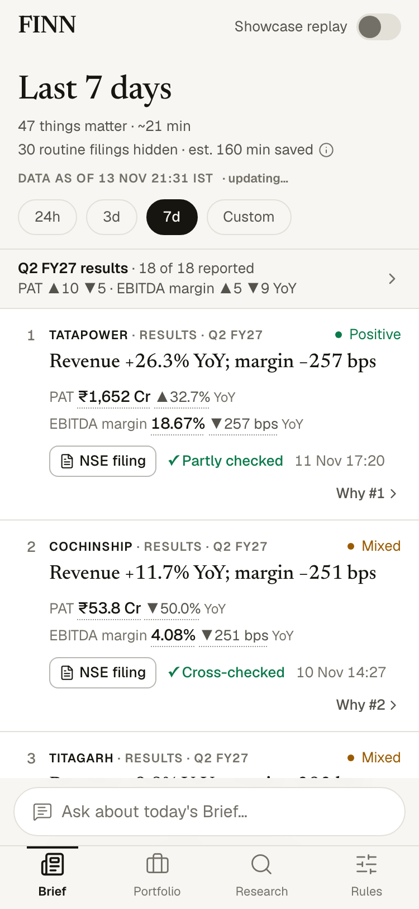
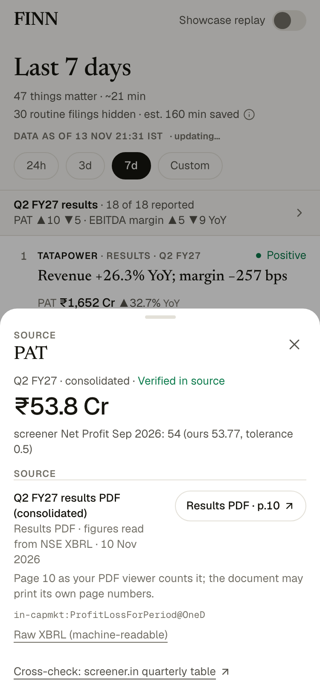
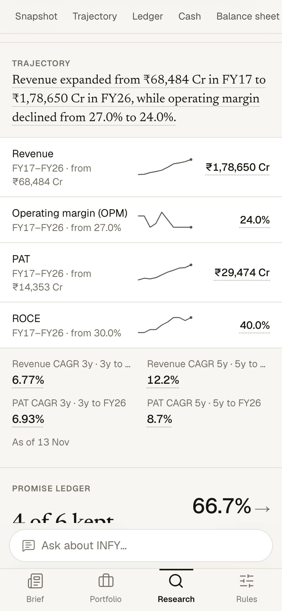
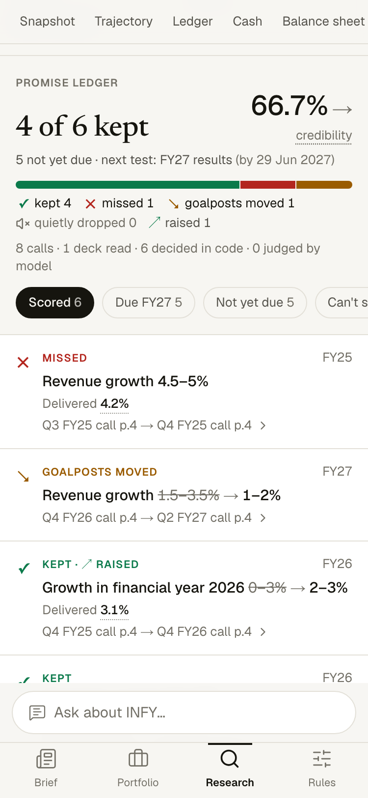
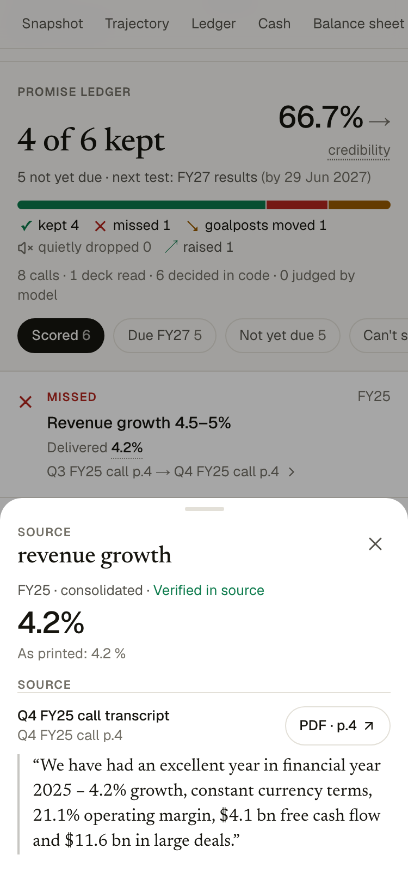
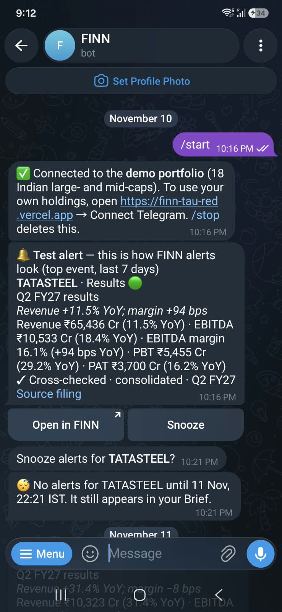
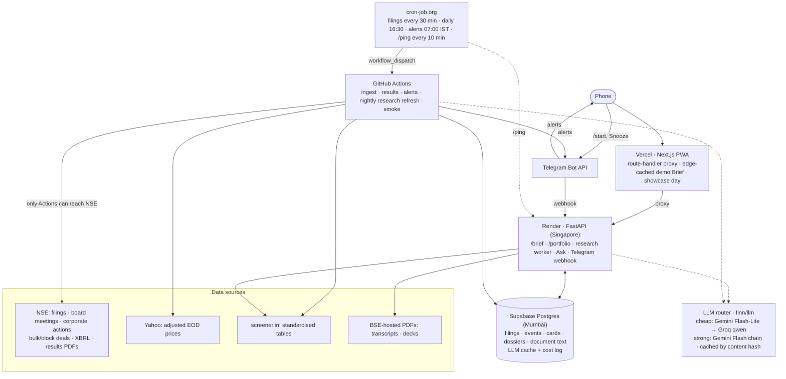

# FINN

**An investor doesn't need more information about their portfolio. They need less of it, with proof for what's left.**

FINN is a portfolio editor for Indian equities (NSE). It reads every filing, price move and earnings-call transcript, and shows only what changes your view. Every number on screen opens the document, page and quote it came from. It was built for the ENAM AI Engineer Build Challenge. The five product principles:

1. **Default to silence; earn every interruption.** Hiding routine filings is the core value.
2. **Show your proof.** Every number and claim links to its source document and page. If something can't be verified, FINN says so and never guesses.
3. **Personal, not generic.** Importance depends on what you hold, how much, and what you're watching.
4. **Under 30 seconds to value.** Instant load, the answer first, detail one tap away.
5. **Push and pull are one loop.** What research learns makes alerts smarter, and alerts lead into research.

## Try it


**https://finn-tau-red.vercel.app**: best on a phone.

- No login. A demo portfolio of 18 NSE holdings is pre-loaded.
- On a laptop the link shows this QR and a live phone preview.
- **Real push:** Rules → *Connect Telegram* sends a test alert within seconds. Sending `/start` to `@finn_shlok_bot` also works.
- **Research:** open Research and type any NSE ticker. INFY, BAJFINANCE, POLYCAB and PERSISTENT are prebuilt.

The API runs on Render's free tier, which can sleep. The first screen never waits for it: it comes from Vercel's edge cache, or from a saved showcase day with a clear label.

<br clear="right">

<table>
<tr>
<td align="center" width="33%"><br><sub><b>Brief:</b> 47 things that matter in 7 days; 30 routine filings hidden</sub></td>
<td align="center" width="33%"><br><sub><b>Any number → its source:</b> results PDF page, XBRL element, screener cross-check</sub></td>
<td align="center" width="33%"><br><sub><b>Dossier</b> for any NSE ticker, from primary sources</sub></td>
</tr>
<tr>
<td align="center"><br><sub><b>Promise Ledger:</b> management's guidance vs what was delivered</sub></td>
<td align="center"><br><sub><b>Every verdict cites the calls,</b> with the verbatim quote and page</sub></td>
<td align="center"><br><sub><b>Telegram:</b> Test alert after /start: a cross-checked results card with Open in FINN and Snooze</sub></td>
</tr>
</table>

<sub>App screenshots: the deployed site at 375 px with the demo portfolio, 14 Nov 2026. Telegram: the product owner's phone.</sub>

## How it works

**Push: tell me what changed and why it matters.**
- **Fetch.** Every 30 minutes (08:00–22:30 IST, weekdays) a GitHub Actions job fetches the holdings' NSE announcements, board-meeting notices, corporate actions and bulk/block deals. Prices (adjusted for splits, bonuses and dividends) come once a day after the close.
- **Classify.** First NSE's own label, then rules, then Gemini Flash-Lite, which reads the first PDF pages only when the subject line says nothing. **82.5 % of filings never reach a model.** When a filing could be routine or material, it counts as material.
- **Thread.** The filings about one event (notice → outcome → deck → call → newspaper ad) collapse into one card.
- **Results cards.** Numbers come from three XBRL filings (current, previous and year-ago quarter). Code computes EBITDA, QoQ and YoY, then checks every line against screener's quarterly table. The card shows "✓ Cross-checked", "Partly checked" or "Couldn't verify — open the filing" (no numbers). Each figure opens the results PDF at the statement page.
- **Rank.** score = category × position size × relevance × novelty × surprise, and "Why #N" shows the breakdown. Swipes become visible, resettable rules.
- **Deliver.** Telegram, with a budget of 5 a day, batching, snooze, and quiet hours from 22:00 to 07:00 IST. Only M&A, a CEO/MD exit or a rating downgrade breaks quiet hours.

**Pull: research any NSE ticker, grounded in primary sources.**
- **Sources.** screener's standardised tables, plus earnings-call transcripts and investor decks hosted on BSE. The first build takes a few minutes and is cached after that.
- **Dossier sections:** snapshot, 10-year trajectory, Promise Ledger, cash quality, balance sheet, what analysts keep asking, bull vs bear.
- **Promise Ledger.** Every forward-looking statement from up to the last 8 calls is set against what was delivered.
  - **Code** scores numeric promises: kept, missed, goalposts moved, quietly dropped.
  - **The model** judges only qualitative ones, and must cite both calls.
  - **Credibility:** the % appears only from 5 scored promises upward.
- **Ask.** Answers about one company from its own facts and passages. A number that isn't printed in a cited source gets withheld as "Not found in sources".
- **The loop.** The ledger suggests up to 3 drivers per holding ("What you're watching"). Confirmed drivers boost matching events in the Brief.

## Architecture



- **NSE returns 403 to Render**, so every NSE fetch runs on GitHub Actions and writes to Supabase. The API reads only Supabase, screener and BSE-hosted PDFs.
- **GitHub's own cron fired a fraction of its slots** (keepalive: 3 runs in ~19 h), so cron-job.org triggers the workflows through `workflow_dispatch`. GitHub cron stays as a backup, and a slot check stops the two from doubling up.
- **Rules before models; cheap before strong.** Flash-Lite classifies and extracts. The strong chain (Gemini 3.8 Flash → 3 Flash → 3.6 Flash) writes only the ledger's qualitative verdicts and the summary. Every call is cached by content hash and logged with tokens and list-price cost.

## Evals

### Announcement classification: dev vs blind held-out

| Set | Mode | Accuracy on decided | Coverage | Overall |
|---|---|---|---|---|
| Dev (60 filings, Aug–Nov 2026, portfolio) | Rules only | 96.5 % (55/57) | 95 % | 91.7 % |
| Dev | Full ladder | 100 % (60/60) | 100 % | 100 % |
| **Held-out** (20 filings, 11–12 Nov 2026, other companies) | Rules only | **80.0 %** (12/15); before review 66.7 % | 75 % | 60.0 %; before review 50.0 % |
| **Held-out** | Full ladder | **80.0 %** (16/20); before review 70.0 % | 100 % | 80.0 %; before review 70.0 % |

- **The dev set is optimistic:** the rules were written from the same months of filings.
- **How the held-out set was drawn:** with a logged seed, stratified by NSE label, one filing per company, with no company that FINN had seen.
- **How it was labelled:** blind, by a fresh agent that never saw the code, rules or dev set. It got only the category definitions and read every PDF itself. The labels were committed (`5e015db`) before the classifier ran.
- **Review:** the product owner reviewed all 6 disagreements, confirmed 4 of the agent's labels and corrected 2. Both numbers are shown above.
- **Frozen:** no rule or prompt was changed because of a held-out miss.
- **Main failure mode:** subject lines that don't describe the attached PDF (a "guarantees" subject on a results outcome). Those companies also filed the standard results outcome, so their results card still appears. Details and the next step are in [DECISIONS](docs/DECISIONS.md#2026-11-13--held-out-classification-independent-blind-labels-reviewed).

### Results extraction ([REPORT.md](backend/evals/results/REPORT.md))
- **Method:** card figures (read from NSE XBRL) were checked against the company's own results PDF for the 5 most recent results cards, within printed precision. Scanned pages were read from the rendered image.
- **Result: 57/60 fields (95 %).** Revenue, EBITDA, PBT and PAT were 20/20.
- **The 3 misses** are TITAGARH's comparatives, restated in the later filing; FINN uses the XBRL as first reported.
- **Verification states across all 17 results cards at the eval run:** 14 cross-checked with screener, 2 partly checked (a lender's NII/PPOP has no screener row), 1 couldn't verify (numbers hidden).
- **What the cross-check found on the first run:** real accounting-layout differences, now reconciled from sourced facts. Each is described [in DECISIONS](docs/DECISIONS.md#2026-11-10--results-reconciling-the-xbrl-layout-with-screener-first-real-run).
  - Where the JV share sits relative to PBT.
  - A bank tagging minority interest as an exceptional item.
  - Excise duty inside gross revenue.
  - A lender (NBFC) misread as a bank.

### Promise Ledger ([LEDGER.md](backend/evals/research/LEDGER.md))
- **265/265 cited quotes are on their cited page**, across 7 dossiers and 119 promises. Every quote is re-checked against the stored page text.
- **Independent audit:** 5 verdicts were drawn with a fixed seed. A separate agent downloaded the PDFs and read the pages itself: 10/10 quotes were on their pages, and all 5 verdicts follow from the evidence.
- **Investor decks raised the number of scored promises honestly**; the n ≥ 5 bar for showing a % was not lowered. FINN reads the deck for the quarter that closes a promise's period, and BAJFINANCE went from 1 of 4 to 8 of 13 scored.

| Ticker | Promises | Kept | Missed | Goalposts moved | Quietly dropped | Credibility |
|---|---|---|---|---|---|---|
| BAJFINANCE | 37 | 8 | 4 | 1 | 0 | 8 of 13 · 62 % |
| INFY | 18 | 4 | 1 | 1 | 0 | 4 of 6 · 67 % |
| LAXMIDENTL | 16 | 1 | 2 | 0 | 1 | 1 of 4 |
| POLYCAB | 24 | 0 | 0 | 2 | 0 | 0 of 2 |
| PERSISTENT | 11 | 1 | 0 | 1 | 0 | 1 of 2 |
| HDFCBANK | 13 | 1 | 0 | 0 | 0 | 1 of 1 |

The remaining promises are not yet due (FY27 and later) or can't be scored (no date, or a benchmark-relative target).

### End to end
- **Walkthrough** (`web/e2e/walkthrough.spec.ts`, run against the deployed site at 375 px and 1280 px): **15/15**.
  - Covers: landing + QR + live preview, the Brief, swipe + UNDO, a card's readable source, the ledger's provenance sheet, Ask, Rules, and the Connect Telegram deep link.
  - Its manual step builds a never-seen ticker. It found three general bugs, all fixed (PLAN.md, Phase 5).
- **Robustness** ([ROBUSTNESS.md](backend/evals/research/ROBUSTNESS.md)): 5 random NSE tickers (logged seed) through the deployed API.
  - 4 built partial dossiers.
  - TATACAP's build failed: a quote with no words divided by zero. It was fixed and rebuilt.
  - Every Brief returned 0 cards for those untracked symbols, which used to read as "caught up". It now says "not tracked yet".
- **Live push latency** ([PUSH_CHECK.md](backend/evals/PUSH_CHECK.md)): **5 min 2 s** from filing to phone. ALKEM's CFO appointment was filed on NSE at 13:58:26 IST and reached Telegram at 14:03:28 through the normal scheduler, classification and ranking, with nothing triggered by hand. Most of the wait is the 30-minute slot spacing.
- **Smoke test** (`.github/workflows/smoke.yml`, daily): GETs cached pages and API routes only, and fails loudly.

## Cost ([COST.md](backend/evals/COST.md))

FINN pays **$0**: Gemini, Groq, GitHub Actions, Render, Vercel and Supabase are all on free tiers. At paid list price:

| Unit | Model calls | List price |
|---|---|---|
| 30-min filing check | 1.2 cheap on average (0 when nothing is new) | ≈ $0.001 |
| Daily post-close ingest | ~22 cheap | ≈ $0.015 |
| First-time dossier (with transcripts) | ~8 cheap + 2 strong | ≈ $0.17 (mean of 11 first builds) |
| Cached dossier / nightly refresh with no new document | 0 | $0 |
| Ask (new question) | 1 cheap | ≈ $0.001 |
| Drivers for one holding | ≤ 3 cheap | ≈ $0.08 |

**82.5 % of filings never reach a model:** 27.7 % are classified by NSE's own label and 54.8 % by rules (947 stored filings, 12 Nov). The binding constraint is the strong models' 20 requests a day each, not money. That's why numeric verdicts are computed in code and a dossier's summary is reused unless its documents change.

## Key decisions

All decisions, with context and the alternatives considered, are in [docs/DECISIONS.md](docs/DECISIONS.md). The main ones:

- **[The LLM reads, code calculates.](docs/DECISIONS.md#the-llm-reads-code-calculates)** Models extract quotes or write language. Every ratio, growth rate, comparison and numeric verdict is Python.
- **[NSE only from GitHub Actions](docs/DECISIONS.md#2026-11-10--nse-is-fetched-only-by-github-actions-the-api-never-calls-nse), [triggered by cron-job.org](docs/DECISIONS.md#2026-11-10--external-scheduler-cron-joborg-triggers-keepalive-and-ingest-github-cron-is-the-backup)**, because NSE blocks Render and GitHub's scheduler was unreliable.
- **[Material over routine when unsure.](docs/DECISIONS.md#2026-11-10--ambiguous-between-routine-and-material--material)** A wrongly hidden filing is never seen; a wrongly shown one costs a swipe.
- **[Results from three XBRL filings, cross-checked](docs/DECISIONS.md#2026-11-10--results-from-three-xbrl-filings-cross-checked-pdf-fallback)**, with **[readable sources](docs/DECISIONS.md#2026-11-12--readable-open-links-product-owners-bug-a-figure-opened-raw-xbrl-xml-on-a-phone)**. A raw XBRL link on a phone became "open the results PDF at the statement page".
- **[Promise Ledger: code judges numbers, the model judges language.](docs/DECISIONS.md#2026-11-10--promise-ledger-code-judges-numbers-the-model-judges-language)**
- **[Telegram over web push](docs/DECISIONS.md#push-through-telegram-web-push-not-offered); [PWA over native](docs/DECISIONS.md#pwa-over-a-native-app).**
  - Web push on iPhone needs a home-screen install, Android battery savers delay it, and WhatsApp needs business approval.
  - The PWA gives zero-install access.
- **[Quiet hours](docs/DECISIONS.md#2026-11-11--quiet-hours-what-breaks-through)**, from a real bug: a results alert reached the product owner's phone at 00:43. Now only M&A, a CEO/MD exit or a rating downgrade breaks through.
- **[Holdings stay on the phone](docs/DECISIONS.md#2026-11-10--holdings-browser-by-default-opt-in-server-copy-for-push)**, with an opt-in server copy (symbols + weights only) when Telegram is connected.
- **[First paint under 1 s while Render may be asleep.](docs/DECISIONS.md#2026-11-12--first-paint--1-s-while-render-may-be-asleep)**
- **[No re-drawn snippet image for sources.](docs/DECISIONS.md#2026-11-14--sources-open-the-original-document-no-re-drawn-snippet-image)** A picture FINN draws adds no trust over the company's own filing.

## Known limitations

What happens if nobody touches FINN for a month:

| Risk | When | What FINN does |
|---|---|---|
| **A Gemini model is retired or renamed** | Google retires preview models with weeks of notice | Model ids come from env vars (`GEMINI_MODEL_*`), so the fix is one value, checked with `python -m finn.llm.check`. Meanwhile, the NSE label and rules still classify ~82 % of filings; the rest wait in the hidden drawer as "retried next run". Groq takes short calls and Ask. If every strong model is gone, dossiers keep their last good summary. |
| **The GitHub token in cron-job.org expires** | about 8 Feb 2027 (90-day token) | Dispatches fail with 401 and cron-job.org emails after 3 failures. GitHub's own cron (the backup) keeps the jobs running, less punctually. Fix: [DEPLOY.md §6a](docs/DEPLOY.md). |
| **GitHub disables scheduled workflows** after 60 days without a commit | ~mid-January 2027 | cron-job.org's dispatches don't depend on schedules. Only the backup cron and the daily smoke stop. |
| **Supabase free tier pauses** after 7 days idle | only if every job stops | The 30-minute jobs and the 10-minute `/ping` keep it active. If it pauses: the Brief serves the phone's last copy or the showcase day, labelled; the demo dossiers fall back to committed fixtures. |
| **Render free tier sleeps** | after 15 min idle | The keepalive keeps it warm. If that stops, the first request waits ~50 s, and the app shows cached data and "waking up". |
| **NSE changes its API or blocks GitHub's runners** | unpredictable | Runs fail and are logged. The Brief shows a "stale" banner once the feed is 2 h behind, and every screen says "Data as of …". The smoke test fails when data is over 4 days old. |
| **screener.in redesigns** | unpredictable | Cross-checks become "pending" (numbers shown, unverified). New dossiers show "not found in sources" for computed sections; existing ones keep their last good copy. |
| **Free-model daily quotas** | every day | Builds park as "waiting for quota" and resume after the 13:30 IST reset. Ask stops at 40 new answers a day (8 per visitor); cached answers stay free. |

By design or not yet fixed:
- **Restated comparatives.** Prior quarters come from the XBRL as first reported, so a later restatement isn't reflected (TITAGARH in the results eval).
- **Misleading subject lines.** A filing whose subject doesn't describe its PDF is classified by the subject (the held-out failure mode above).
- **Summary sentences are reused** until a dossier's documents change. The snapshot's text can therefore quote an older market cap than the figure beside it; the text is labelled with the day it was written.
- **New listings.** Autocomplete uses a committed NSE symbol list, refreshed by hand.
- **Not editable in the UI yet:** per-stock price-move overrides and the Level-2 thesis line exist in the contract but have no editor.

## Deliberately left out

| What | Why |
|---|---|
| **Web push** | Reaches iPhones only after "Add to Home Screen", and Android battery savers delay it. Telegram works the same on every phone. |
| **Annual-report red flags** | Cut at the Phase 5 time-box. The section is hidden rather than shown as "coming soon". |
| **On-demand NSE data for never-seen tickers** (filing timeline, XBRL results in the dossier) | NSE blocks Render, so this needs a guarded GitHub dispatch per ticker ([designed](docs/DECISIONS.md#2026-11-10--on-demand-nse-data-via-workflow-dispatch-with-guardrails), not built). The core dossier runs on screener and BSE-hosted PDFs without it. |
| **A re-drawn image of each cited snippet** | It adds no trust over the original filing, which opens at the cited page. |
| **Intraday data** | The brief asks for end of day. Intraday data feeds the noise FINN filters, and it needs paid feeds. |
| **Login / multi-user** | Friction for evaluators, and days of secure-auth work. |
| **Portfolio P&L, buy/sell calls** | Brokers already do P&L. Recommendations are SEBI-regulated advice; FINN informs judgment. |
| **News and broker notes in research** | Primary sources only. The one exception is a new executive's professional background, labelled "web · unverified". |
| **A learned ranking** | One user and little data. Visible ×0.8 / ×1.25 rules can be explained and reset. |

## Next steps

1. **In-app viewer of the original filing**, opened at the cited page with the figure highlighted on the document itself.
2. **Classification:** read the first PDF page when the attachment name (`RESULTS…`, `Outcome_Board…`) or a same-day results board meeting suggests results, even if the subject doesn't.
3. **Restated comparatives:** take prior-quarter figures from the newest filing that prints them.
4. **Annual-report red flags:** auditor qualifications, contingent liabilities, related-party transactions, disappearing KPIs.
5. **On-demand NSE data** for never-seen tickers, as designed.
6. **Team sharing** (login), and WhatsApp once business verification is done.

## Run locally

Python 3.12 venv at the repo root, then the API and the web app:

```bash
/opt/anaconda3/bin/python3.12 -m venv .venv && .venv/bin/pip install -e "backend[api,jobs,dev]"
```

```bash
cd backend && ../.venv/bin/uvicorn api.main:app --reload --port 8000
```

```bash
cd web && npm install && API_BASE_URL=http://127.0.0.1:8000 npm run dev
```

Copy `.env.example` to `.env` and fill it in (setup click by click: [docs/DEPLOY.md](docs/DEPLOY.md)). Tests and checks:

```bash
cd backend && ../.venv/bin/pytest -q && ../.venv/bin/ruff check .
```

```bash
cd web && npm run lint && npm run typecheck
```

Evaluator walkthrough against the deployed site:

```bash
cd web && npx playwright install chromium && npm run e2e
```

Evals, from `backend/`: `python -m evals.classification.run --set dev|heldout [--model]` · `python -m evals.results.run` · `python -m evals.research.ledger_report` · `python -m evals.cost_report`.

**Contracts:** Pydantic models in `backend/finn/models/` are the source of truth. After changing them, run `cd web && npm run gen:schema && npm run gen:types`. CI fails if `web/lib/types.ts` is stale.

| Path | What |
|---|---|
| `web/` | Next.js 16 PWA (App Router, TypeScript, Tailwind, shadcn/ui, framer-motion) → Vercel. `web/e2e/` = Playwright walkthrough |
| `backend/finn/` | Shared Python package: sources, classification, ranking, extraction, research, llm, models |
| `backend/api/` | FastAPI → Render: Brief, Portfolio, research, Ask, Telegram webhook |
| `backend/jobs/` | Scheduled jobs: ingest, results, alerts, nightly research refresh, smoke |
| `backend/evals/` | Eval sets and reports |
| `.github/workflows/` | `ci` · `ingest` (+ nightly `research-refresh`) · `backfill` · `keepalive` · `smoke` · `spike-ci` |

| Job (cron-job.org → `workflow_dispatch`; GitHub cron as backup) | When (IST) |
|---|---|
| Filing checks | every 30 min, 08:00–22:30, weekdays (exchange holidays included) |
| Daily post-close ingest | 16:30 |
| Alerts held overnight | released at 07:00 |
| Research refresh | nightly, with the first filing slot from 22:00 |
| Smoke test | daily, 09:00 |

## AI build history

FINN was built with Claude Code, one session per phase. The logs are in **[docs/ai-logs/](docs/ai-logs/README.md)**, whose index has one line per phase. Each log keeps the prompts, plans, approvals and replies, plus the tool calls.

They were redacted before committing, because the repo is public. `scripts/transcript_to_md.py` turns a session transcript into a condensed log, and it exits 2 if it finds emails, local paths or secret-like strings:

```bash
python3 scripts/transcript_to_md.py --transcript <session>.jsonl --out docs/ai-logs/phase-N-name.md --title "Phase N — name"
```

Product spec: [docs/PRODUCT.md](docs/PRODUCT.md) · Decisions: [docs/DECISIONS.md](docs/DECISIONS.md) · Data sources: [docs/DATA_SOURCES.md](docs/DATA_SOURCES.md) · Deploy: [docs/DEPLOY.md](docs/DEPLOY.md) · Backlog: [docs/PLAN.md](docs/PLAN.md)
